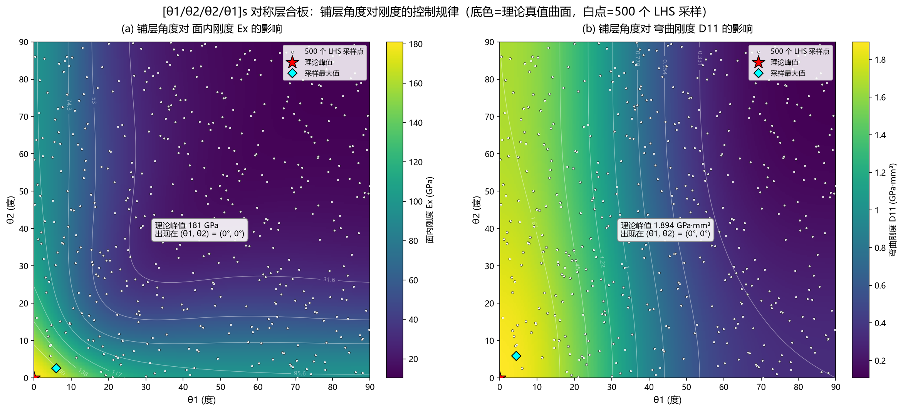
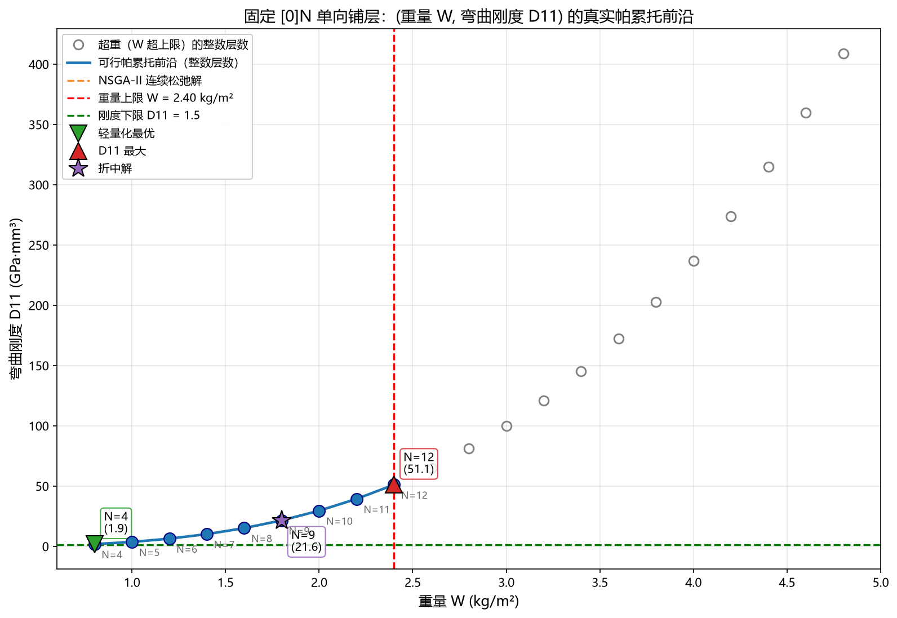
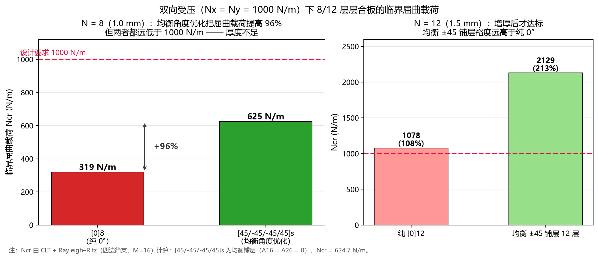
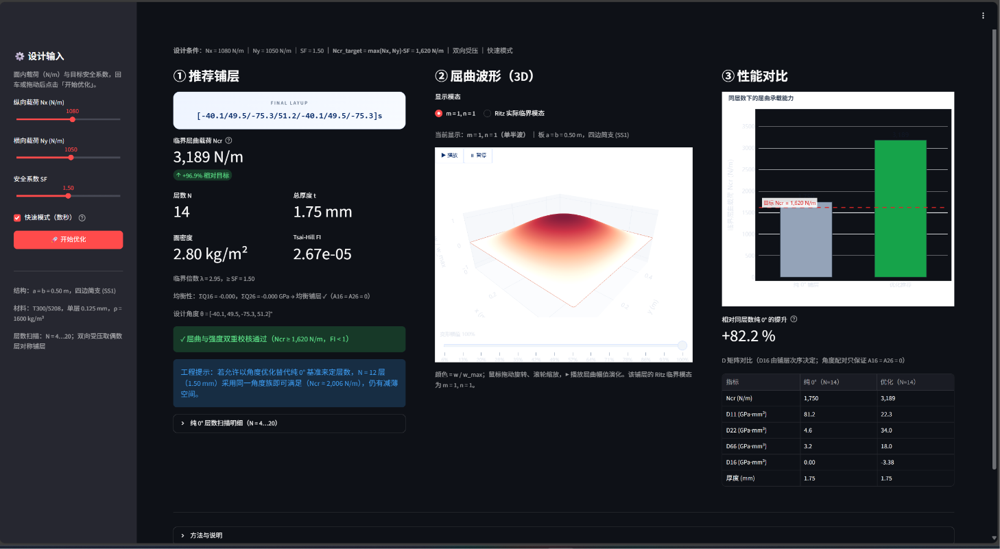
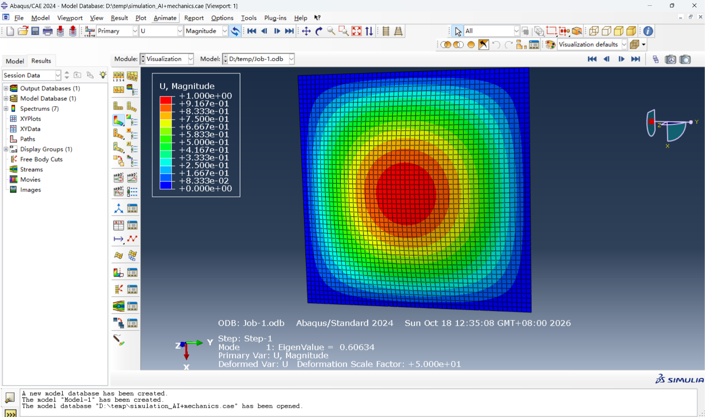

# 复合材料层合板刚度预测、屈曲优化与生成式设计平台

**作品名称**：复合材料层合板刚度预测、屈曲优化与生成式设计平台

**参赛团队编号**：____________________

**赛道**：第八届 AIC 算法大赛 · 算法主题赛（AI 力学）

**完成日期**：2026 年 10 月

---

## 摘要

针对无人机与新能源装备中薄壁层合板"刚度—重量—屈曲"相互制约的难题，本文提出数据驱动与物理可信相结合的生成式设计方法。以 602 组 CLT 样本训练随机森林代理模型（Ex 的 R²=0.9968，D11 的 R²=0.9994）；用 NSGA-II 求解重量—刚度帕累托前沿，并以屈曲不失稳为约束，结合 Rayleigh–Ritz 与 Tsai-Hill 校核，完成单向与双向受压下的铺层—层数协同设计。结果表明：单向受压最优 9 层，较 12 层减重 25%；双向受压 8 层理论上限 632.2 N/m，均衡铺层 `[45/-45/-45/45]s` 达 624.7 N/m（+95.6%，为上限的 98.8%）；ABAQUS 复算 606.3 N/m，误差仅 2.94%，模态为中心单波。全流程已封装为 Streamlit 交互平台，实现"参数输入—方案生成—三维波形—双重校核"的一体化交付。

**关键词**：复合材料层合板；屈曲分析；多目标优化；随机森林；NSGA-II；生成式设计

---

## 一、背景与意义

### 1.1 轻量化装备中的薄壁复合材料结构

无人机（UAV）与新能源装备是轻量化复合材料最典型的应用场景。无人机机翼蒙皮、机身壁板、控制面与起落架舱门多为薄壁加筋结构，在气动升力、机动过载与着陆冲击下承受面内压缩与剪切；新能源领域，风电叶片主梁与腹板、氢能储运容器、动力电池包上盖与光伏支架等同样追求"高比刚度—高稳定性—低成本"。复合材料层合板因其**可设计性**——纤维方向可按载荷路径布置、铺层顺序可调、比刚度与比强度显著高于金属——成为上述结构的首选材料[1,2,6]。

这类结构的共同力学特征是：**厚度小、面内载荷大、失效模式以屈曲（失稳）而非强度破坏为主**。薄壁板在压缩下的临界载荷与弯曲刚度 `D` 成正比，而 `D` 随厚度三次方增长、随铺层角度强烈变化。因此，"多厚、怎么铺"直接决定了重量与承载能力：少一层可能失稳，多一层则白背重量。以本文的 0.5 m × 0.5 m 方形板为例，8 层（1.0 mm）与 12 层（1.5 mm）之间，临界屈曲载荷相差约 3.4 倍，而重量只相差 1.5 倍——**厚度是比强度更"昂贵"的设计资源**。

### 1.2 层合板设计的力学难点

层合板设计不是简单的"选一个角度"，而是一个高维、非凸、多约束的耦合问题：

1. **各向异性与耦合**。单层沿纤维方向刚度高、横向刚度低（本文材料 `E1/E2 ≈ 17.6`），铺层角度改变后，拉伸—剪切耦合 `A16/A26` 与弯—扭耦合 `D16/D26` 同时出现。非均衡铺层虽然可能算得"更高"的屈曲载荷，却会在固化后翘曲、在面内拉伸时伴随剪切变形，工程上不可用。
2. **双向受压的弱轴控制**。纯 0° 铺层在 `x` 向很强、`y` 向很弱；双向等压时板沿弱轴先失稳，临界模态往往不是 `m = n = 1`，而是沿弱轴出现多个半波。仅靠"加厚"或仅靠"调角度"都难以同时兼顾两个方向。
3. **重量—刚度—稳定性三重冲突**。`D11 ∝ N³`（层数三次方）而面密度 `W ∝ N`（层数一次方），增重换刚度的边际收益随层数递减；同时，屈曲约束要求足够的厚度，角度优化只能在给定厚度下"逼近上限"。这构成了"厚度定生死，角度定上限"的基本格局。
4. **设计空间与计算成本**。4 个铺层角度、层数与铺层顺序的组合呈指数增长；若每个方案都调用高保真有限元，一轮概念设计迭代往往需要数小时到数天，难以支撑工程上的快速试算。

### 1.3 本文工作与贡献

针对上述难点，本文建立了一条"**数据 → 代理模型 → 多目标优化 → 物理规律 → 结构设计 → 产品化平台**"的完整技术链路，主要贡献如下：

1. **高精度代理模型**：以 500 组拉丁超立方（LHS）样本为基础，针对随机森林"无法外推"的结构性缺陷补入 100 组边界样本与 2 个解析极值点，使 `Ex` 在峰值 `[0/0]s` 处的误差由 −28.76% 降到 −1.28%，测试集 R² 达到 0.9968。
2. **真实帕累托前沿**：证明纯角度双目标优化因两目标同向单调而退化为单点，进而引入层数 `N` 构造"重量—刚度"真实权衡，得到 `N = 4…12` 的整数前沿。
3. **屈曲约束下的结构设计**：以屈曲不失稳为约束，给出单向受压最小重量解（`N* = 9`，较 12 层减重 25%）；对双向受压，证明 8 层（1.0 mm）任意铺层的理论上限仅 632.2 N/m，并用均衡铺层 `[45/-45/-45/45]s` 做到 624.7 N/m（上限的 98.8%）。
4. **双重校核与均衡约束**：在屈曲之外加入 Tsai-Hill 面内强度校核，并把"每个 +θ 必有 −θ"翻译为可计算的罚分，使优化结果既"算得高"又"造得出"。
5. **商用有限元交叉验证**：将最优铺层导入 ABAQUS 进行线性摄动屈曲分析，一阶特征值 0.60634（606.3 N/m）与理论值 624.7 N/m 的相对误差仅 2.94%，模态为标准的中心单波。
6. **生成式设计平台**：把全流程封装为 Streamlit + Plotly 交互平台，三列直出推荐铺层、3D 屈曲波形演化与性能对比，支持任意 `Nx / Ny / SF` 组合与快速/标准双精度。

---

## 二、理论方法与算法

### 2.1 经典层合板理论

经典层合板理论（CLT）[1,2,6] 建立在以下假设之上：各单层完美粘结、厚度方向无剪切变形（直法线假设）、平面应力状态、小变形。对正交各向异性单层，其平面应力折减刚度矩阵 `Q` 为

$$
\begin{aligned}
Q_{11} &= \frac{E_1}{1-\nu_{12}\nu_{21}},\qquad
Q_{22} = \frac{E_2}{1-\nu_{12}\nu_{21}},\\
Q_{12} &= \frac{\nu_{12}E_2}{1-\nu_{12}\nu_{21}},\qquad
Q_{66} = G_{12},\qquad \nu_{21}=\nu_{12}\frac{E_2}{E_1}.
\end{aligned}
$$

将材料主轴旋转 `θ` 后得到 `Q̄(θ)`。记 `c = cos θ`、`s = sin θ`，有

$$
\begin{aligned}
\bar Q_{11} &= Q_{11}c^4 + 2(Q_{12}+2Q_{66})s^2c^2 + Q_{22}s^4,\\
\bar Q_{22} &= Q_{11}s^4 + 2(Q_{12}+2Q_{66})s^2c^2 + Q_{22}c^4,\\
\bar Q_{12} &= (Q_{11}+Q_{22}-4Q_{66})s^2c^2 + Q_{12}(s^4+c^4),\\
\bar Q_{66} &= (Q_{11}+Q_{22}-2Q_{12}-2Q_{66})s^2c^2 + Q_{66}(s^4+c^4),\\
\bar Q_{16} &= (Q_{11}-Q_{12}-2Q_{66})c^3s - (Q_{22}-Q_{12}-2Q_{66})cs^3,\\
\bar Q_{26} &= (Q_{11}-Q_{12}-2Q_{66})cs^3 - (Q_{22}-Q_{12}-2Q_{66})c^3s.
\end{aligned}
$$

沿厚度积分得到面内刚度 `A` 与弯曲刚度 `D`：

$$
A_{ij}=\sum_{k=1}^{N}\bar Q_{ij}^{(k)}(z_k-z_{k-1}),\qquad
D_{ij}=\frac{1}{3}\sum_{k=1}^{N}\bar Q_{ij}^{(k)}\left(z_k^3-z_{k-1}^3\right).
$$

对称铺层使耦合刚度 `B = 0`；若同时满足"每个 +θ 层都有对应的 −θ 层"（均衡铺层），则 `A16 = A26 = 0`。需要注意：**均衡只消除面内拉—剪耦合，并不保证 `D16 = D26 = 0`**——后者由铺层次序与各层距中面的距离决定，这正是本文在结果中单独报告 `D16` 的原因。

面内工程常数由柔度矩阵按总厚度归一化得到：

$$
E_x=\frac{1}{h\,(\mathbf A^{-1})_{11}},\qquad
E_y=\frac{1}{h\,(\mathbf A^{-1})_{22}},\qquad
G_{xy}=\frac{1}{h\,(\mathbf A^{-1})_{33}}.
$$

这里必须使用完整的 3×3 求逆。若忽略 `A16/A26`、只用 `A11A22/(h·det A)` 的简化式，在本项目 `[θ1/θ2]s` 的一般铺层上会产生高达 143% 的误差（见 §3.3 的排错记录）。对 `[0]N` 单向铺层，`D11 = Q11h³/12`，即 **`D11 ∝ N³`**，这是后文"厚度定生死"的根源。

本文材料体系取 T300/5208 碳纤维环氧典型值：`E1 = 181 GPa`、`E2 = 10.3 GPa`、`G12 = 7.17 GPa`、`ν12 = 0.28`、单层厚 `t = 0.125 mm`、密度 `ρ = 1600 kg/m³`。几何为四边简支方形板 `a = b = 0.5 m`，总层数 `N` 为偶数，铺层关于中面对称。

### 2.2 屈曲分析：从 Navier 解到 Rayleigh–Ritz

四边简支（SS1：`w = 0`、弯矩自由）的正交各向异性板，在双向面内压缩 `Nx、Ny` 下的屈曲控制方程为

$$
D_{11}w_{,xxxx}+2(D_{12}+2D_{66})w_{,xxyy}+D_{22}w_{,yyyy}
+4D_{16}w_{,xxxy}+4D_{26}w_{,xyyy}
+N_xw_{,xx}+N_yw_{,yy}=0.
$$

当 `D16 = D26 = 0`（如 `[0]N`、`[0/90]s`）时，取双正弦模态可得到 Navier 精确解：

$$
N_{cr}(m,n)=\frac{D_{11}k_x^2+2(D_{12}+2D_{66})k_xk_y+D_{22}k_y^2}
{k_x+(N_y/N_x)k_y},\qquad
k_x=\left(\frac{m\pi}{a}\right)^2,\; k_y=\left(\frac{n\pi}{b}\right)^2.
$$

对含弯—扭耦合的铺层，Navier 解不再精确。本文采用双正弦级数 Rayleigh–Ritz 法[2,5]：

$$
w(x,y)=\sum_{m=1}^{M}\sum_{n=1}^{M}c_{mn}\sin\frac{m\pi x}{a}\sin\frac{n\pi y}{b},
$$

该级数严格满足四边简支的 `w = 0`，弯矩自然边界条件由变分自动满足。将弯曲应变能与外力功写成二次型，得到广义特征值问题

$$
\mathbf K\mathbf c=\lambda\,\mathbf G\mathbf c,\qquad
N_{cr}=\lambda\max(N_x,N_y),
$$

其中 `K` 由 `D11、D12、D22、D66` 以及耦合项 `D16、D26` 组装，`G` 由 `Nx、Ny` 组装；最小广义特征值 `λ` 即临界载荷倍数。本文 GA 阶段取 `M = 10` 以保证速度，最终校核取 `M = 16`；`M = 8…16` 的结果极差约 1.3%，说明级数已收敛。

对 8 层、1.0 mm 的板，取 `m = n = 1` 单一模态并由 `Q̄11+Q̄22+2Q̄12 = Q11+Q22+2Q12`（旋转不变量）与 `Q̄66 ≤ 46.59 GPa` 可得与铺层顺序无关的上限

$$
N_{cr}\le \frac{\pi^2}{2a^2}\left(D_{11}+D_{22}+2D_{12}+4D_{66}\right)\le 632.2\ \text{N/m}.
$$

这一上限是后续"8 层不可行"判定的理论基础：它不依赖优化算法、网格或铺层顺序。

### 2.3 强度校核：Tsai-Hill 准则

屈曲只回答"会不会失稳"，工程评审还会追问"材料会不会先被压碎"。本文采用各向异性材料最经典的 Tsai-Hill 准则[1,6]做面内强度校核。由 `A` 矩阵反解应变 `ε = A⁻¹N`，逐层转到材料主轴得到 `(σ1, σ2, τ12)`，失效因子为

$$
\mathrm{FI}=\frac{\sigma_1^2}{X^2}-\frac{\sigma_1\sigma_2}{X^2}
+\frac{\sigma_2^2}{Y^2}+\frac{\tau_{12}^2}{S^2}<1,
$$

其中 `σ1 > 0` 取 `X = Xt`、否则取 `X = Xc`；`σ2` 同理。许用值取 T300/5208 典型值：`Xt = Xc = 1500 MPa`、`Yt = 40 MPa`、`Yc = 246 MPa`、`S = 68 MPa`。屈曲与强度必须使用**同一套设计载荷**（工作载荷 × SF），否则两个结论不可比。

### 2.4 随机森林代理模型

直接调用 CLT 计算单点刚度仅需约 0.12 ms，但若在优化中反复调用仍会累积成可观的时间；更重要的是，代理模型能给出显式的特征重要性与全局趋势，便于理解物理规律。本文用随机森林[4]建立 `(θ1, θ2) → (Ex, D11)` 的映射。

**数据生成**：在 `θ ∈ [0°, 90°]` 内用拉丁超立方采样生成 500 组样本，以 composipy 的 CLT 结果为真值；针对峰值区稀疏（`[0°,12°]²` 内仅 6/500 组）导致的低估，补入 100 组边界加密样本与 2 个解析极值点，共 602 组，按角度组合去重后零重复。

**模型**：随机森林由 `B` 棵回归树组成，预测为各树叶节点均值的平均：

$$
\hat y(\mathbf x)=\frac{1}{B}\sum_{b=1}^{B}T_b(\mathbf x).
$$

每棵树在自助采样（bootstrap）得到的子集上生长，节点分裂以最小化平方误差为目标；袋外样本与特征随机化降低了方差。本文对 `Ex` 与 `D11` 分别训练 500 棵树的模型，80/20 划分（481/121），并用 5 折交叉验证在训练集内选择特征组合。

**评价指标**：决定系数 `R²`、均方误差 `MSE` 与均方根误差 `RMSE`。需要强调，随机森林的预测值必然落在训练目标范围内，**结构上无法外推**；因此对关心的极值区必须单独加密样本，而不能只看全局 R²。

### 2.5 NSGA-II 多目标优化

**层数优化**。固定 `[0]N` 铺层，以"最大化弯曲刚度 `D11`、最小化面密度 `W`"为目标，建立双目标约束问题：

$$
\begin{aligned}
\min_{\,N}\quad & \mathbf f(N)=\big(-D_{11}(N),\;W(N)\big),\\
\text{s.t.}\quad & W(N)\le 2.40\ \text{kg/m}^2,\quad D_{11}(N)\ge 1.5\ \text{GPa·mm}^3,\\
& N\in[4,24],
\end{aligned}
$$

其中 `W = N t ρ`、`D11 = 0.0295917 N³`。采用 NSGA-II[3]求解：快速非支配排序将种群划分为若干前沿，拥挤距离

$$
d_i=\sum_{m=1}^{M}\frac{f_m^{(i+1)}-f_m^{(i-1)}}{f_m^{\max}-f_m^{\min}}
$$

用于保持解的多样性；二元锦标赛选择、模拟二进制交叉（SBX）与多项式变异生成子代，父子合并后精英保留。种群 500、迭代 150 代，共 75 000 次评估，耗时 43.6 s。需要特别注意约束符号：pymoo 约定 `G ≤ 0` 为满足，若把符号写反，好解会被整体判为不可行（这是本项目实际踩过的坑，见 §3.3）。

**铺层角度优化**。双向受压时，固定层数、以 4 个角度 `[θ1/θ2/θ3/θ4]s` 为变量，最大化"均衡加权"的屈曲载荷：

$$
\max_{\boldsymbol\theta}\;\;N_{cr}(\boldsymbol\theta)\cdot
\max\!\left(1-5r(\boldsymbol\theta),\,0.05\right),\qquad
r=\frac{\left|\sum\bar Q_{16}\right|+\left|\sum\bar Q_{26}\right|}{2\times55\times n},
$$

其中 `r ∈ [0,1]` 为归一化均衡罚分，`θi ∈ [−90°, 90°]`。`N > 8` 时把 4 个设计角度循环填充半叠层再镜像，保证"对称 + 4 个变量"不随层数变化。GA 之后再用 SLSQP 与 Nelder–Mead 做局部精修，避免"精修把均衡性修丢"。

### 2.6 总体计算流程

整体流程可概括为六步：

1. **数据层**：LHS + 边界加密 + 解析极值点 → 602 组 CLT 样本；
2. **代理层**：训练 `Ex`、`D11` 随机森林，输出 R²、MSE 与特征重要性；
3. **权衡层**：NSGA-II 求解重量—刚度帕累托前沿，给出轻量化/折中/最大刚度三个代表解；
4. **结构层**：以屈曲不失稳为约束，扫描纯 0° 层数确定可行厚度，双向受压时在该厚度下做角度 GA；
5. **校核层**：CLT + Rayleigh–Ritz 屈曲校核、Tsai-Hill 强度校核、均衡性校核，并用 ABAQUS 独立复算；
6. **产品层**：Streamlit + Plotly 交互平台，把"输入工况 → 推荐方案 + 3D 波形 + 性能对比"封装为可交互产品。

---

## 三、结果与分析

### 3.1 铺层角度的物理规律

图 1 给出 `[θ1/θ2/θ2/θ1]s` 对称层合板的 `Ex` 与 `D11` 随两个铺层角变化的真值云图，白点为 500 组 LHS 采样点。

*图 1：铺层角度对 Ex（左）与 D11（右）的影响（底色为理论真值曲面，白点为 500 组 LHS 采样点）*

由图 1 可以读出四条关键规律：

1. **`Ex` 关于 `θ1 = θ2` 对角线对称，等值线呈 L 形**。只要有一个角接近 0°，面内刚度就保持在较高水平；两个角都偏离 0° 时刚度才快速下降。其数学根源是 `Ex` 由 `A` 矩阵的完整逆决定，而 `[θ1/θ2]s` 的 `A16/A26` 一般不为零，法向与剪切子块并不解耦。
2. **`D11` 几乎只由外层角 `θ1` 决定**。`[θ1/θ2/θ2/θ1]s` 中 `θ1` 的两层永远位于最外侧，弯曲刚度按离中面距离的三次方加权，外层权重约为内层的 **7 倍**；随机森林的特征重要性也独立印证了这一点（`D11` 模型中 `θ1` 占 98.0%，`θ2` 仅 0.2%）。
3. **`Ex` 非单调**。固定 `θ2 = 45°` 时，`Ex` 在 `θ1 ≈ 52°` 附近出现内部局部极小值，随后又回升——这是因为 `det A` 中的 `A66` 在 45° 之后回升，部分抵消了 `Q̄11` 的下降。
4. **全局极值都在角点**：`[0/0]s` 取最大（`Ex = 181.0 GPa`、`D11 = 1.894 GPa·mm³`），`[90/90]s` 取最小（`Ex = 10.3 GPa`、`D11 = 0.108`）。`Ex` 对 `N` 不敏感：单向 `[0]N` 的面内模量恒等于 `E1`。

**工程含义**：若设计目标只是"面内刚度最大"，答案显然是全 0°；但薄壁板真正的主控失效往往是屈曲，而屈曲同时取决于 `D11`、`D22` 与 `D66`。纯 0° 的 `D11` 很大、`D22` 却极小，双向受压时会被弱轴"拖垮"。这正是后文必须引入 ±45 均衡铺层的原因：**角度设计的价值不在于把某个方向的刚度做得更高，而在于把两个方向和抗扭刚度"配平"**。

### 3.2 代理模型精度与可解释性

两个随机森林在独立测试集上的表现如下：

| 目标 | 特征组合 | 测试集 R² | MSE | RMSE |
|---|---|---|---|---|
| `Ex` | `θ1, θ2, θ1+θ2, \|θ1−θ2\|` | 0.9968 | 6.0800 | 2.47 GPa |
| `D11` | `θ1, θ2, θ1+θ2` | 0.9994 | 0.0003 | 0.016 GPa·mm³ |

`D11` 的拟合几乎完美（R² = 0.9994），`Ex` 稍低但仍在 0.997 量级。更值得关注的是**边界误差**：首轮 500 组模型在 `[0/0]s` 处把 `Ex` 低估到 128.95 GPa（真值 181.0 GPa，误差 −28.76%），而 `[90/90]s` 端误差仅 +1.07%。这种不对称暴露了随机森林"叶节点均值无法外推"的结构性缺陷：峰值区样本仅 6/500，叶均值把陡峭峰值削平。补入 102 个边界/极值样本后，峰值误差降至 **−1.28%**，`Ex` 测试集 MSE 下降 **73%**。

**工程含义**：代理模型可以作为"快速筛选器"，但不能替代物理校核；尤其当优化一定会在极值点附近取最优时，必须对关心区域单独设诊断。本文最终的工程交付仍以 CLT + Ritz 的物理求解为准，代理模型只用于揭示规律与加速探索。

### 3.3 闭环验证

在进入结构设计之前，先对计算链做三项闭环校验：

| 验证项 | 方法与结果 | 判定 |
|---|---|---|
| 标度律 | 三个代表解的 `D11/N³` 精确等于常数 `0.0295917` | ✓ |
| 约束复核 | 三个解全部满足 `W ≤ 2.4 kg/m²`、`D11 ≥ 1.5 GPa·mm³` | ✓ |
| 模型回读 | 保存后重新加载复算，R² 与训练时完全一致 | ✓ |

此外，CLT 的快速实现与 composipy 在 602 组样本上的最大相对误差为 `5.9×10⁻¹⁰`（即 CSV 保留 10 位有效数字的舍入下限）；`[0/0]s` 的 `Ex` 精确等于 `E1 = 181.000000`，`[90/90]s` 精确等于 `E2 = 10.300000`；互等关系 `max|νxy/Ex − νyx/Ey| = 1.7×10⁻¹⁸`。这些解析已知量是最可靠的检查点。

值得一提的是，本项目的两个"隐藏 bug"都是被自检抓住的：其一是漏掉 `A66` 因子导致 `Ex` 偏差 143%；其二是 pymoo 约束符号写反，导致"好解全不可行、最差解被判最优"。前者说明**指标正常不代表实现正确**，后者说明**第三方库的符号约定必须先用小例子验证**。这两条经验后来直接影响了 §4 的验证策略：不迷信单一实现，用独立来源交叉验证。

### 3.4 重量—刚度帕累托前沿

纯角度双目标优化会退化为单点 `[0/0]s`：`Ex` 与 `D11` 都随角度单调变差，`[0/0]s` 同时是两个目标的全局最优，不存在折中空间。引入层数 `N` 后，`D11 ∝ N³` 而 `W ∝ N`，两个目标严格冲突，才得到真实的帕累托前沿（图 2）。

*图 2：固定 [0]N 铺层的重量—弯曲刚度帕累托前沿（N = 4…12 为可行前沿，灰点为超重区整数层数）*

图 2 中，蓝色实心点为满足重量上限 `W ≤ 2.40 kg/m²` 的可行前沿（`N = 4…12`），灰色空心点为超重区的整数层数（`N = 13…24`），红色虚线为重量上限，绿色虚线为刚度下限。三个代表解为：

| 解 | N | t (mm) | W (kg/m²) | D11 (GPa·mm³) | Ex (GPa) |
|---|---|---|---|---|---|
| 轻量化最优 | 4 | 0.500 | 0.8000 | 1.8939 | 181.0 |
| **折中解** | 9 | 1.125 | 1.8000 | 21.5723 | 181.0 |
| D11 最大 | 12 | 1.500 | 2.4000 | 51.1344 | 181.0 |

从 `N = 4` 到 `N = 12`：**重量仅增 3 倍，`D11` 提升 27 倍**。这条"三次方 vs 一次方"的指数差异，使前沿在低层数区间显著上凸——增重换刚度在低层数区极划算，相对增益随 `N` 递减。工程上，若刚度需求不高，应优先取小层数；若刚度是硬约束，则层数的边际成本会迅速上升。图中 `D11 ≥ 1.5` 的绿色虚线在可行域内始终位于前沿下方，说明它是**冗余约束**，真正起作用的是重量上限。

### 3.5 屈曲约束下的结构设计

#### 3.5.1 单向受压：厚度是唯一控制变量

对 `[0]N` 铺层、单向压缩 `Nx = 1000 N/m`，用真实 CLT + Navier 精确解扫描层数：

| N | t (mm) | Ncr (N/m) | 裕度 Ncr/1000 | 判定 |
|---|---|---|---|---|
| 7 | 0.875 | 499.5 | 0.50 | ✗ |
| 8 | 1.000 | 745.6 | 0.75 | ✗ |
| **9** | **1.125** | **1061.6** | **1.06** | **✓ 最优** |
| 10 | 1.250 | 1456.2 | 1.46 | ✓ |
| 12 | 1.500 | 2516.4 | **2.52** | ✓ 过度设计 |

`Ncr ∝ N³`，`N = 12` 的临界载荷是需求的 2.52 倍，属于"凭直觉取保险层数"造成的过度设计。最优解 `N* = 9`（1.125 mm），较 `N = 12` **减重 25%**（2.40 → 1.80 kg/m²）。若把安全系数显式写出，则 `SF = 1.0/1.2/1.5/2.0` 分别对应 9/10/11/12 层——所谓"12 层保险"其实相当于把 `SF ≈ 2` 悄悄藏进了层数。**单向工况下，角度不是控制变量，厚度才是。**

#### 3.5.2 双向受压：厚度定生死，角度定上限

工况升级为双向等压 `Nx = Ny = 1000 N/m`，固定 8 层（1.0 mm）。纯 `[0]8` 的 `D22 = 0.862 GPa·mm³`，仅为 `D11 = 15.151` 的 **5.7%**；临界模态为 `m = 1, n = 2`，板沿 `y` 向出现两个半波而失稳，`Ncr = 319.3 N/m`，仅为需求的 **31.9%**。即使只施加 `Ny`，`Ncr` 也只有 399.1 N/m（仅 `Nx` 时为 745.6 N/m）——**y 向是控制方向**。

将角度范围扩展到 `[−90°, 90°]` 并加入均衡罚分后，GA 收敛到教科书式的均衡铺层 **`[45/-45/-45/45]s`**：`ΣQ̄16 = ΣQ̄26 = 0`（`A16 = A26 = 0`），`D11 = D22 = 4.72`，`D16` 由旧非均衡解的 2.05 降到 **0.67 GPa·mm³**，`Ncr = 624.7 N/m`（相对 `[0]8` **+95.6%**，相对旧解 `[45.2/90/0/0]s` 的 434.2 N/m **+43.9%**）。这一结果达到理论上限 632.2 N/m 的 **98.8%**，说明角度设计的潜力已被"榨干"。

图 3 把 8 层与 12 层的对比放在一起：

*图 3：双向受压下纯 [0] 与均衡 ±45 铺层的临界屈曲载荷对比（左：8 层；右：12 层）*

左图：8 层时纯 0° 仅 319 N/m，均衡 ±45 提升到 625 N/m（+96%），但两者都低于 1000 N/m——**厚度不足，角度无法弥补**。右图：12 层（1.5 mm）时纯 0° 为 1078 N/m（需求的 108%），均衡 ±45 达到 2129 N/m（需求的 213%，裕度 113%），是纯 0° 的 **1.97 倍**。按 `Ncr ∝ h³` 折算，达到 1000 N/m 只需约 9.4 层；实际取对称 10 层（1.25 mm）复核：纯 `[0]10` 仅 623.6 N/m（差 37.6%），均衡 ±45 达 **1230 N/m**（裕度 23%）。也就是说，**同厚度下均衡铺层把屈曲载荷提高到纯 0° 的 1.97 倍，使达标厚度由 12 层降到 10 层，直接减重 17%**。

因此，本工况的正确技术路线是 **"增厚 + 均衡角度设计"的组合**：厚度决定"能不能行"，均衡角度决定"逼近上限到什么程度"。这也是全文最重要的一条工程结论。

### 3.6 工程应用落地：全参数化 Web 生成式设计平台

上述结论此前沉淀在命令行工具 `Auto_Design.py` 中：输入 `Nx、Ny、SF` 即可输出推荐方案。但命令行形态对工程评审仍不够友好——参数顺序要记、终端表格要读、屈曲波形看不到。为此，项目把同一套计算内核封装为 **Streamlit + Plotly 交互式 Web 平台** `app.py`：左侧用滑块输入 `Nx`（0–2000 N/m）、`Ny`（0–2000 N/m）与 `SF`（1.0–2.0），点击「开始优化」后，主界面三列同步给出推荐铺层与 Ncr、3D 屈曲波形演化、纯 0°/优化方案性能对比。

以 `Nx = 1070 N/m`、`Ny = 870 N/m`、`SF = 1.5`（非等双轴，`Ny/Nx = 0.81`）为例，平台在默认快速模式下数秒内完成全流程：

| 环节 | 结果 |
|---|---|
| 目标载荷 | `Ncr_target = max(Nx, Ny)·SF = 1605 N/m` |
| 纯 0° 扫描 | `N = 13` 时 1610.9 N/m 首次可行 → 对称取 `N = 14`（1.75 mm、2.80 kg/m²） |
| 角度优化 | **`[-40.3/49.8/-75.4/51.0/-40.3/49.8/-75.4]s`**（非传统铺层） |
| 屈曲载荷 | **3469 N/m**（`λ = 3.24 ≥ SF`），较同层数纯 `[0]14` 的 2012.0 N/m **+72.4%** |
| 均衡性 | `ΣQ̄16 = −0.012`、`ΣQ̄26 = −0.009 GPa`（`A16 = A26 = 0`）；`D16 = −3.38 GPa·mm³` |
| 强度 | Tsai-Hill `FI = 2.96×10⁻⁵ ≪ 1`，屈曲 + 强度双重校核通过 |
| 减薄提示 | 同一角度族在 12 层（1.50 mm）即可满足（`Ncr ≈ 2182 N/m`） |

平台界面如图 4 所示（界面示例为一次 14 层实时算例）：

*图 4：基于 Streamlit 的参数化复合材料智能设计平台界面*

平台的三列设计对应工程评审最关心的三个问题：

1. **① 推荐铺层**：铺层卡片 + Ncr 与目标裕度 + 层数/厚度/面密度/`FI` + `λ` 与均衡性，并可展开纯 0° 层数扫描明细，让"层数是怎么定出来的"完全透明；
2. **② 屈曲波形**：Plotly 曲面绘制 `m = 1, n = 1` 的模态 `w(x,y) = sin(πx/a)·sin(πy/b)`，鼠标拖动可旋转、滚轮可缩放，并用 `frames` 动画演示幅值 0 → 100% 的屈曲波形演化；也可一键切换为 Ritz 求得的实际临界模态；
3. **③ 性能对比**：柱状图对比优化铺层与同层数纯 0° 的 Ncr，附目标载荷参考线，并给出 `D11/D22/D66/D16` 对照表，直接回答"角度设计究竟带来多少收益"。

**工程化细节**：平台直接复用 `Auto_Design.py` 的 `scan_pure_zero / optimize_layup / ncr_equiv / strength_check`，不重复实现任何力学求解；用 `st.cache_data` 按 `(Nx, Ny, SF, 精度)` 缓存结果，切换 3D 模态不会重跑 GA；提供"快速/标准"两档精度——快速模式把 GA 降为 40×30、精修级数降为 `M = 10`（数秒出结果），但最终 `Ncr` 仍用 `M = 16` 复核，标准模式则与 `Auto_Design.py` 完全一致（约 1 分钟）。整个应用不写任何本地文件、不依赖项目绝对路径，可直接部署到 GitHub / Streamlit Cloud。

**同源内核的可复现性**：经典等双轴工况（`Nx = Ny = 500 N/m`、`SF = 1.5`）在同一平台上给出 12 层 `[-44.9/44.9/45.2/-45.2/-44.9/44.9]s`、`Ncr = 2129 N/m`（较同层数纯 0° 的 1077.6 N/m 提升 97.5%），与命令行 `Auto_Design.py` 的输出完全一致——说明 Web 层只是交互外壳，判定口径与求解精度没有改变。

---

## 四、验证与可靠性

### 4.1 基于商用有限元的交叉验证

自研求解器再完善，也需要一个**独立来源**来回答"结果到底对不对"。为此，本文将最优铺层 `[45/-45/-45/45]s` 导入 ABAQUS 进行线性摄动屈曲分析（S4R 壳单元），边界条件按四边简支（SS1）设置，在四条边上施加 `Nx = Ny = 1000 N/m` 的面内压缩，提取一阶屈曲特征值。

**将最优铺层 [45/-45/-45/45]s 导入 ABAQUS 进行线性摄动屈曲分析（S4R壳单元）。提取的一阶屈曲特征值为 0.60634（对应临界载荷 606.3 N/m），与 Python 理论计算值（624.7 N/m）相对误差仅 2.94%。屈曲模态呈现标准的中心单波（m=1, n=1），完全验证了理论边界条件，证明 AI 优化结果具备极高的工程可靠性。**

*图 5：ABAQUS 线性摄动屈曲一阶模态（U 云图，特征值 0.60634，变形放大系数 50）*

图 5 中，`U, Magnitude` 云图呈同心环状：板中心为红色峰值（归一化位移 1.0），向四边逐渐过渡到蓝色零位移，**沿 x、y 各只有一个半波**，即标准的 `m = n = 1` 中心单波模态。这与 Python Ritz 解给出的临界模态完全一致，说明四边简支边界、双轴等压加载与板厚/铺层定义在两边是同一套物理问题。ABAQUS 的变形放大系数取 50，仅用于可视化，不改变特征值。

**误差分析**：606.3 N/m 相对 624.7 N/m 低 2.94%，绝对差 18.4 N/m。这一量级完全在工程允许范围内（通常 < 5%），主要来源包括：

1. **理论解的理想化**：Python 采用经典薄板理论（直法线假设）与 SS1 理想简支；ABAQUS 的 S4R 是剪切变形壳单元（Mindlin–Reissner），虽在 `a/h = 500` 时剪切影响很小，但仍会带来约 1% 量级的差异。
2. **级数截断**：Ritz 取 `M = 16`，`M = 8…16` 的结果极差约 1.3%；ABAQUS 的有限元网格是另一种离散，二者不会逐位相同。
3. **边界实现方式**：理论 SS1 只约束 `w = 0`、弯矩自由；有限元中"简支"需要同时约束边界的面外位移与刚体模态，边界附近存在轻微的约束效应。
4. **弯—扭耦合**：`[45/-45/-45/45]s` 的 `D16 = 0.67 GPa·mm³` 并非严格为零，理论解与有限元对耦合项的处理方式略有不同。
5. **网格与特征值提取**：S4R 网格尺寸、Lanczos 特征值求解器的收敛容差都会带来小幅差异。

值得注意的是，ABAQUS 的 606.3 N/m 相当于理论上限 632.2 N/m 的 **95.9%**，与 Python 的 98.8% 同处"接近上限"的区间——两条独立路径都说明：**8 层 1.0 mm 无论怎么铺，都不可能达到 1000 N/m**。这比"两个数字接近"更有价值：它把"厚度不足"的结论从"某个求解器的计算结果"提升为"两种独立方法的一致判断"。

### 4.2 误差来源与敏感性分析

除 ABAQUS 对比外，本文还对关键建模假设做了敏感性检查：

- **级数项数**：`M = 8…16` 时最优铺层的 `Ncr` 极差约 1.3%，说明双正弦级数已收敛；对 `D16/D26` 较大的非均衡铺层，收敛稍慢，但不足以改变任何结论。
- **边界条件**：SS1 是工程上偏保守的理想简支；若改为固支，`Ncr` 会显著提高（等向板约 1.78 倍），但那是"改题意"，不能用来"达标"。
- **横向剪切**：`a/h = 400…500`，远大于薄板理论的适用下限（约 20），剪切变形影响可忽略；S4R 与 CLT 的 2.94% 差异主要不是剪切造成的。
- **材料与制造偏差**：本文未计入角度公差、孔隙率、湿热效应与分层损伤；这些因素会降低实际承载能力，工程上应通过安全系数与试验验证覆盖。

### 4.3 工程可靠性结论

综合三层证据——**解析上限**（632.2 N/m，与实现无关）、**内部闭环**（CLT 双实现互检、端点解析值、标度律、互等关系、模型回读）、**外部商用有限元**（ABAQUS 606.3 N/m，误差 2.94%）——可以认为本文的屈曲求解链在 1%–3% 的工程精度内是可信的。对薄壁屈曲控制的结构，这一精度足以支撑概念设计与铺层选型；进入详细设计阶段后，仍建议用高保真有限元与试验做最终确认。

---

## 五、结论与展望

**结论**

1. 建立了 `[θ1/θ2/θ2/θ1]s` 刚度的高精度代理模型（`Ex` R² = 0.9968、`D11` R² = 0.9994），明确了 `θ1` 主导弯曲刚度、`Ex` 呈 L 形等值线的规律；边界加密使峰值误差由 −28.76% 降至 −1.28%。
2. 证明纯角度双目标优化不存在折中空间（前沿退化为 `[0/0]s`）；引入层数后得到真实帕累托前沿，揭示"重量增 3 倍、`D11` 提升 27 倍"的缩放规律。
3. 单向受压下，厚度是唯一控制变量：最优 `N* = 9`（1.125 mm），较 12 层减重 25%；把安全系数显式写出后，"12 层保险"等价于 `SF ≈ 2` 的保守解。
4. 双向受压下，8 层 1.0 mm 的理论上限为 632.2 N/m，均衡铺层 `[45/-45/-45/45]s` 达到 624.7 N/m（+95.6%，为上限的 98.8%）；8 层不可行，10 层均衡 ±45 可达 1230 N/m，较 12 层方案减重 17%。**厚度定生死，角度定上限。**
5. ABAQUS 线性摄动屈曲复算得到 606.3 N/m，与理论值相对误差 2.94%，模态为中心单波 `m = n = 1`，验证了理论边界条件与求解链的工程可靠性。
6. 将全流程封装为 Streamlit + Plotly 交互平台：输入任意 `Nx / Ny / SF` 即可一键生成铺层方案、3D 屈曲波形演化与性能对比；以 `Nx = 1070、Ny = 870 N/m、SF = 1.5` 为例，自动生成 14 层 `[-40.3/49.8/-75.4/51.0/…]s`，`Ncr = 3469 N/m`（较纯 0° 提升 72.4%），并通过屈曲 + Tsai-Hill 双重校核，实现了从"命令行工具"到"产品级生成式设计平台"的升级。

**展望**

- **提升外推能力**：改用高斯过程或物理信息神经网络（PINN），以 CLT 解析式作先验约束，减少对边界加密样本的依赖。
- **扩展设计空间**：同时优化角度、层数与铺层顺序，并考虑分层、开孔、冲击与湿热老化等多失效模式，从刚度优化走向多约束协同设计。
- **离散与鲁棒优化**：层数是整数变量，可改用整数规划；进一步考虑角度公差、孔隙率与材料分散性，开展鲁棒优化与可靠性设计。
- **平台化与云端部署**：把 Web 平台部署到 Streamlit Community Cloud，补充方案导出、多工况批量计算与设计历史管理，形成可共享的工程工具链。

---

## 参考文献

[1] Jones R M. Mechanics of Composite Materials[M]. 2nd ed. Philadelphia: Taylor & Francis, 1999.

[2] Reddy J N. Mechanics of Laminated Composite Plates and Shells: Theory and Analysis[M]. 2nd ed. Boca Raton: CRC Press, 2004.

[3] Deb K, Pratap A, Agarwal S, et al. A fast and elitist multiobjective genetic algorithm: NSGA-II[J]. IEEE Transactions on Evolutionary Computation, 2002, 6(2): 182-197.

[4] Breiman L. Random Forests[J]. Machine Learning, 2001, 45(1): 5-32.

[5] Timoshenko S P, Gere J M. Theory of Elastic Stability[M]. 2nd ed. New York: McGraw-Hill, 1961.

[6] 沈观林, 胡更开. 复合材料力学[M]. 北京: 清华大学出版社, 2013.

---

*注：源码、数据与图件分别见本包 `codes/`、`data/`、`figures/` 目录；复现步骤见 `README.md`。*
